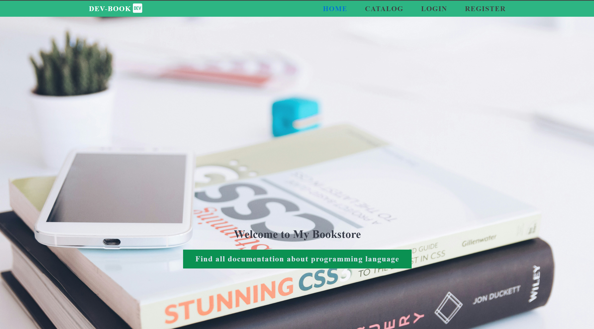
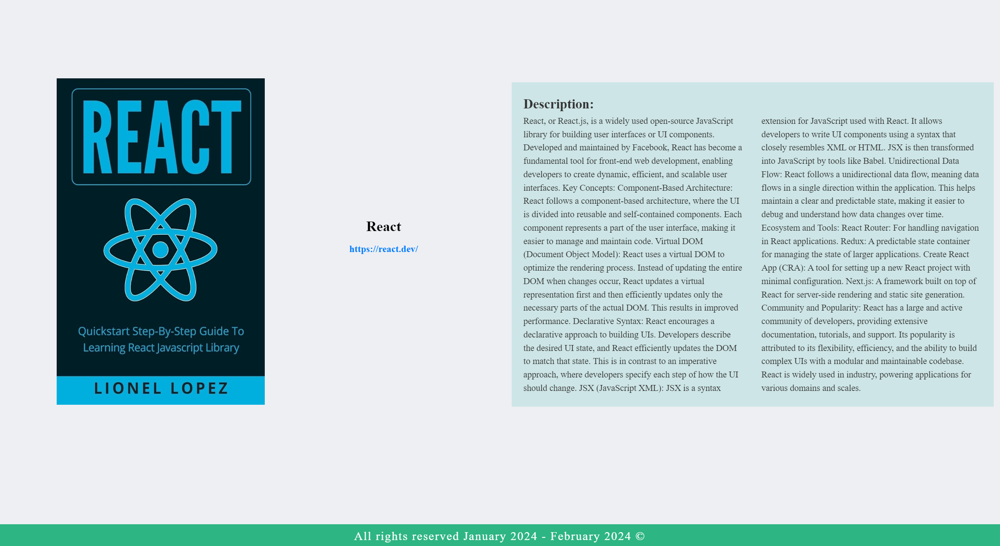

# 📚 DEV-Book

### Full-Stack Book & Knowledge-Sharing Platform

DEV-Book is a full-stack Single Page Application (SPA)
built with React, Node.js, Express.js and MongoDB.

The application allows users to create, manage and
share book entries, organize knowledge about different
technologies and topics, and provide links to useful
learning resources and official documentation.

## 🚀 Key Features

- User registration, login and logout
- JWT-based authentication
- Book catalog and detailed book pages
- Create, read, update and delete operations (CRUD)
- Protected routes and role-based access
- Admin dashboard
- Book submission approval and rejection
- REST API integration
- Form validation and error handling
- Loading, error and empty states
- Responsive web design

## 🛠️ Technologies

| Frontend | Backend | Database & Tools |
| --- | --- | --- |
| React | Node.js | MongoDB |
| JavaScript | Express.js | Mongoose |
| HTML5 | REST API | Git & GitHub |
| CSS3 / CSS Modules | JWT | Postman |
| React Router | bcrypt | Vite |
| Font Awesome | | |

## 🖼️ Application Preview
> 🚧 This project is under active development. Screenshots may reflect an earlier version of the application.

<h2>Project Screenshots:</h2>

<h2>💻 Built with</h2>

Technologies used in the project:
<ul>
<li>JavaScript, HTML & CSS
<li>React JS</li>
<li>Node.js, Express.js and MongoDB
<li>Using Font Awesome for icon</li>
</ul>

# Run application:

      * Open terminal "client" and run:
        * `cd dev-book/client` -> `npm install` (or `npm i`)
        * `npm run dev`
        *  Which opens the app at http://localhost:5173 in your browser.
        
# Run RESTful API server:

    * Open terminal "server" and run:
        * `cd dev-book/server` -> `npm install` (or `npm i`)
        * `npm run csr`
        * server is listening at http://localhost:3030

       
