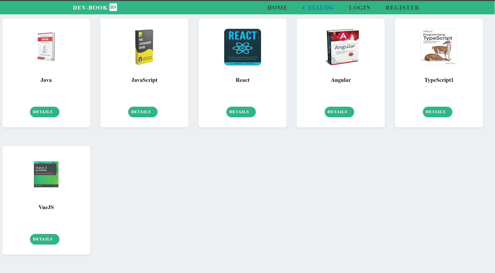
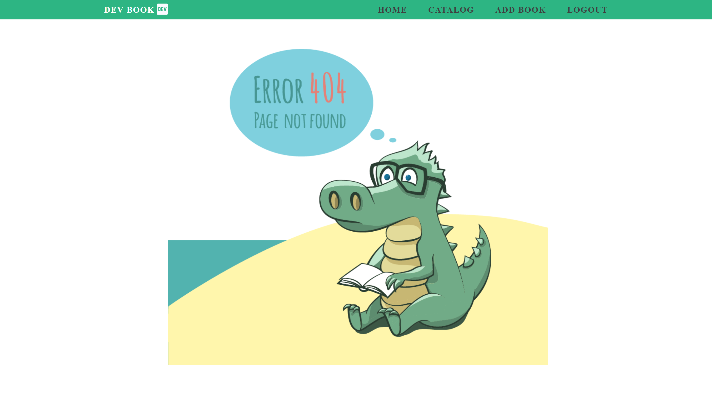

# 📚 DEV-Book

### Full-Stack Book & Knowledge-Sharing Platform

DEV-Book is a full-stack Single Page Application (SPA)
built with React, Node.js, Express.js and MongoDB.

The application allows users to create, manage and
share book entries, organize knowledge about different
technologies and topics, and provide links to useful
learning resources and official documentation.

## 🚀 Key Features

- User registration, login and logout
- JWT-based authentication
- Book catalog and detailed book pages
- Create, read, update and delete operations (CRUD)
- Protected routes and role-based access
- Admin dashboard
- Book submission approval and rejection
- REST API integration
- Form validation and error handling
- Loading, error and empty states
- Responsive web design

## 🛠️ Technologies

| Frontend | Backend | Database & Tools |
| --- | --- | --- |
| React | Node.js | MongoDB |
| JavaScript | Express.js | Mongoose |
| HTML5 | REST API | Git & GitHub |
| CSS3 / CSS Modules | JWT | Postman |
| React Router | bcrypt | Vite |
| Font Awesome | | |

## 🖼️ Application Preview
> 🚧 This project is under active development. Screenshots may reflect an earlier version of the application.
<p align="center"></p>

<h2>Project Screenshots:</h2>
<p align="center"></p>
<p align="center"></p>
<p align="center"></p>
<p align="center"></p>
<p align="center"></p>
<p align="center"></p>
<p align="center"></p>
<p align="center"></p>
<p align="center"></p>


## ⚙️ Getting Started

Follow the instructions below to set up and run the
project locally.

### Prerequisites

- Node.js (compatible with the installed Vite version)
- npm
- Git
- MongoDB (local or MongoDB Atlas)
- Google Cloud Storage credentials for image storage

### 1. Clone the repository

```bash
git clone https://github.com/lyklecharova/DEV-Book.git
cd DEV-Book
```

### 2. Backend Setup

Open a terminal and navigate to the server directory:

```bash
cd dev-book/server
npm install
```

Create a `.env` file using `.env.example` as a template
and configure the required environment variables.

```env
PORT=3030
JWT_SECRET=your_secret_key
MONGO_DB_CONNECTION_STRING=your_mongodb_connection_string
GCS_BUCKET=your_bucket_name
GOOGLE_APPLICATION_CREDENTIALS=./gcs-key.json
```

Ensure that MongoDB is accessible and configure Google
Cloud Storage credentials for image storage.

Start the development server:

```bash
npm run csr
```

Backend URL: http://localhost:3030

### 3. Frontend Setup

Open a second terminal from the repository root:

```bash
cd dev-book/client
npm install
npm run dev
```

Frontend URL: http://localhost:5173

Ensure that the frontend API configuration points to
the local backend when running the project locally.

## 🚧 Project Status

DEV-Book is under active development. New features,
UI improvements, responsive design enhancements and
code improvements are being implemented.

## 👩‍💻 Author

**Lilyana Klecharova**

- [GitHub](https://github.com/lyklecharova)

## 📄 License

This project is licensed under the MIT License.

       
